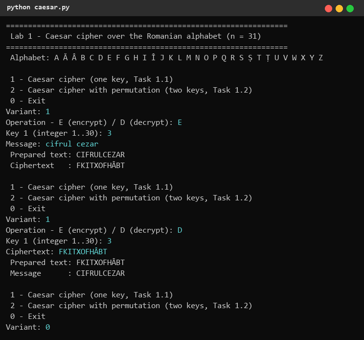
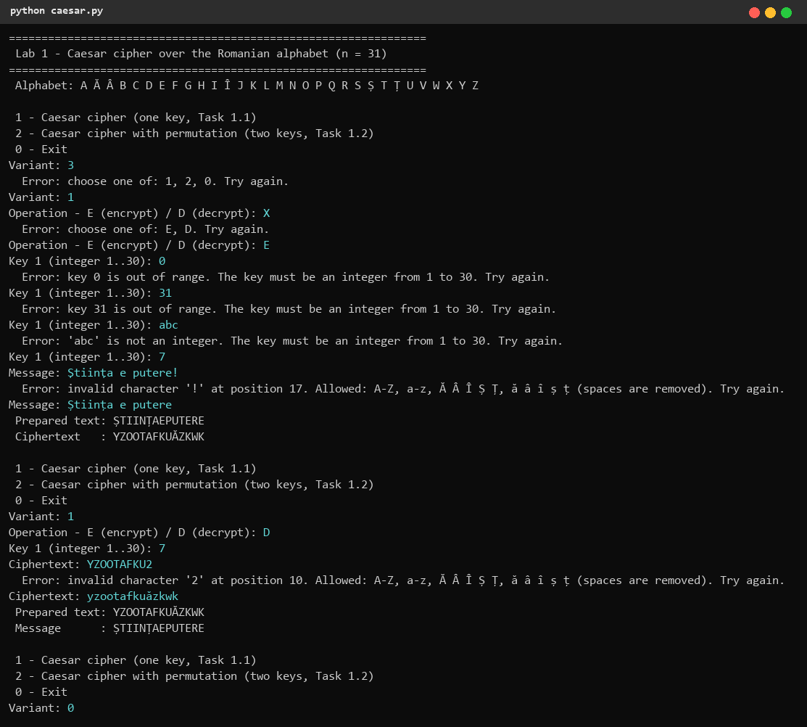
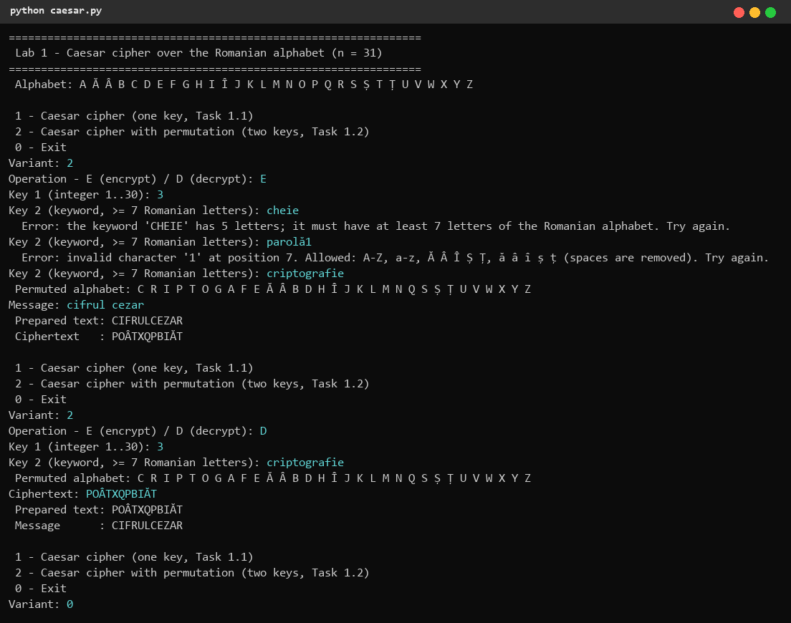

# 1. Short theory

## 1.1 Caesar cipher

The Caesar cipher replaces each plaintext letter with the letter found a fixed number of positions further along the alphabet. Letters are first encoded as numbers (their position in the alphabet, starting from 0); the key k is the shift. For an alphabet of n letters:

    c = e_k(x) = (x + k) mod n
    m = d_k(y) = (y - k) mod n

For the Romanian alphabet n = 31 (A Ă Â B C D E F G H I Î J K L M N O P Q R S Ș T Ț U V W X Y Z, encoded 0..30 as in Table 2 of the lab sheet). The key k = 0 leaves the text unchanged, so the key space is **k ∈ {1, …, 30} — only 30 keys**. Any ciphertext can therefore be broken by brute force: decrypt with every key and keep the only readable candidate.

## 1.2 Caesar cipher with a permutation

A second key, a keyword k2, permutes the alphabet: the distinct letters of the keyword are written first (only the first occurrence of each letter is kept), followed by the remaining letters in their natural order. The shift k1 is then applied to the positions in this new alphabet:

    c = π[(π⁻¹(x) + k1) mod n]
    m = π[(π⁻¹(y) − k1) mod n]

where π is the permuted alphabet and π⁻¹(x) the position of letter x in it. The key space becomes

    31! · 30 = 246,685,159,625,337,684,531,766,886,400,000,000 ≈ 2.47 · 10^35

(with 31! = 8,222,838,654,177,922,817,725,562,880,000,000), which makes brute force impractical. The cipher is still **monoalphabetic**: each plaintext letter always maps to the same ciphertext letter, so frequency analysis breaks it (see Lab 2). Several key pairs give the same substitution, so the number of distinct encryptions cannot exceed 31!.

# 2. Implementation

Both tasks are implemented in one Python 3 console program, `lab1/caesar.py`. The user chooses the variant (1 = Task 1.1, 2 = Task 1.2), the operation (E/D), the keys and the text; every input is validated and asked again on error.

## 2.1 Letter encoding (Table 2)

```python
ALPHABET = ["A", "Ă", "Â", "B", "C", "D", "E", "F", "G", "H", "I", "Î", "J", "K", "L", "M",
            "N", "O", "P", "Q", "R", "S", "Ș", "T", "Ț", "U", "V", "W", "X", "Y", "Z"]
N = len(ALPHABET)                                   # 31
CODE = {letter: i for i, letter in enumerate(ALPHABET)}

UPPER = {low: up for low, up in zip("aăâbcdefghiîjklmnopqrsștțuvwxyz", ALPHABET)}
UPPER.update({"Ş": "Ș", "ş": "Ș", "Ţ": "Ț", "ţ": "Ț"})
UPPER.update({up: up for up in ALPHABET})
```

The encoding is an explicit list, exactly the order of Table 2, so a letter's code is its index in the list — `ord()`/`chr()` are never used. `UPPER` maps every accepted character (lowercase, uppercase and the cedilla variants Ş/Ţ typed by some keyboards) to its uppercase comma-below letter; anything not in this table is rejected.

## 2.2 Text preparation and validation

```python
def normalize(text: str) -> str:
    out = []
    for pos, ch in enumerate(text, start=1):
        if ch == " ":
            continue
        if ch not in UPPER:
            raise InputError(f"invalid character '{ch}' at position {pos}. Allowed: {ALLOWED}.")
        out.append(UPPER[ch])
    ...
    return "".join(out)
```

Spaces are removed, letters are converted to uppercase, and the first invalid character is reported together with its position and the allowed range.

```python
def parse_key(raw: str) -> int:
    ...
    k = int(raw)
    if not 1 <= k <= N - 1:
        raise InputError(f"key {k} is out of range. The key must be an integer from 1 to {N - 1}.")
    return k

def parse_keyword(raw: str) -> str:
    kw = normalize(raw)
    if len(kw) < 7:
        raise InputError(f"the keyword '{kw}' has {len(kw)} letters; it must have at least 7 letters ...")
    return kw
```

The numeric key must be an integer in 1..30; the keyword goes through the same letter check as the text and must have at least 7 letters. The UI helper `ask()` repeats the prompt until the parser accepts the value.

## 2.3 Building the permuted alphabet

```python
def permuted_alphabet(keyword: str) -> list[str]:
    order = []
    for letter in keyword + "".join(ALPHABET):
        if letter not in order:
            order.append(letter)
    return order
```

The keyword is followed by the whole alphabet and only the first occurrence of each letter is kept, which yields the keyword letters (without repetitions) followed by the remaining letters in natural order. For `criptografie` the program prints `C R I P T O G A F E Ă Â B D H Î J K L M N Q S Ș Ț U V W X Y Z`.

## 2.4 Encryption and decryption

```python
def shift(text: str, k: int, alphabet: list[str]) -> str:
    pos = {letter: i for i, letter in enumerate(alphabet)}
    return "".join(alphabet[(pos[ch] + k) % N] for ch in text)

def encrypt(text, k, alphabet=ALPHABET):
    return shift(text, k, alphabet)

def decrypt(text, k, alphabet=ALPHABET):
    return shift(text, (N - k) % N, alphabet)
```

One function serves both variants: with the standard alphabet it is the classic Caesar cipher, with the permuted alphabet it is Task 1.2. Decryption is a shift by n − k, which equals (y − k) mod n and never produces a negative index.

# 3. Results

Task 1.1 — encryption of `cifrul cezar` with k = 3 and decryption of the result:



Check by hand: C = 4 → 7 = F, I = 10 → 13 = K, F = 7 → 10 = I, R = 20 → 23 = T, …, Z = 30 → (30 + 3) mod 31 = 2 = Â. Because Romanian has extra letters (Ă, Â, Î, Ș, Ț) the result `FKITXOFHÂBT` differs from the English example `FLIUXOFHCDU`.

Invalid input — wrong menu option, wrong operation, keys 0, 31 and `abc`, a text with `!`, a ciphertext with a digit; lowercase input and cedilla letters (Ş, ţ) are accepted:



Task 1.2 — keys k1 = 3, k2 = `criptografie`; the keywords `cheie` (too short) and `parolă1` (invalid character) are rejected, the permuted alphabet is displayed:



Check by hand: in the permuted alphabet C has position 0 → position 3 = P; I has position 2 → 5 = O; Z has position 30 → (30 + 3) mod 31 = 2 = I. `CIFRULCEZAR` becomes `POÂTXQPBIĂT`, while the plain Caesar cipher gave `FKITXOFHÂBT`.

# 4. Conclusions

The plain Caesar cipher has only 30 keys over the Romanian alphabet, so an exhaustive search breaks it instantly, even by hand. Permuting the alphabet with a keyword enlarges the key space to 31!·30 ≈ 2.5·10^35 and makes brute force impossible in practice, but it does not hide the letter frequencies: every letter is always replaced by the same letter, so frequency analysis still breaks the cipher. While implementing the program I learned to encode an alphabet explicitly (needed for the Romanian diacritics, including the Ş/Ș and Ţ/Ț variants), to handle the modular arithmetic of decryption without negative indices, and to validate every user input with clear messages.

# 5. Source code

GitHub repository (branch `Cripto`): https://github.com/mihaizastinceanu/Cripto/tree/Cripto/lab1
