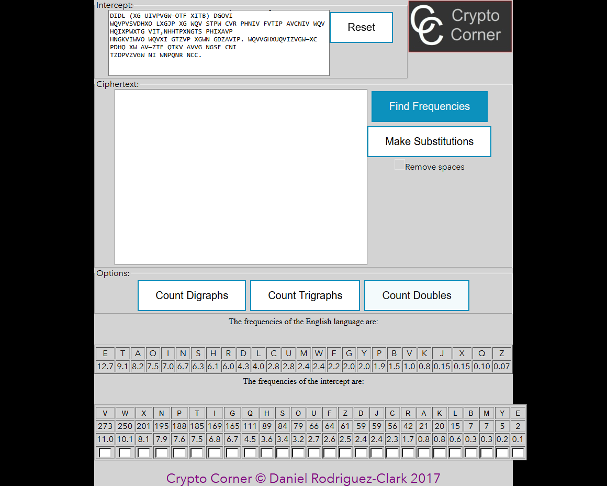
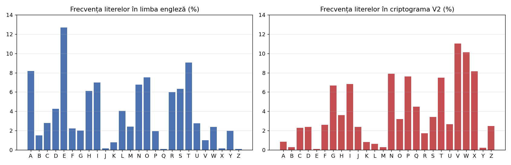
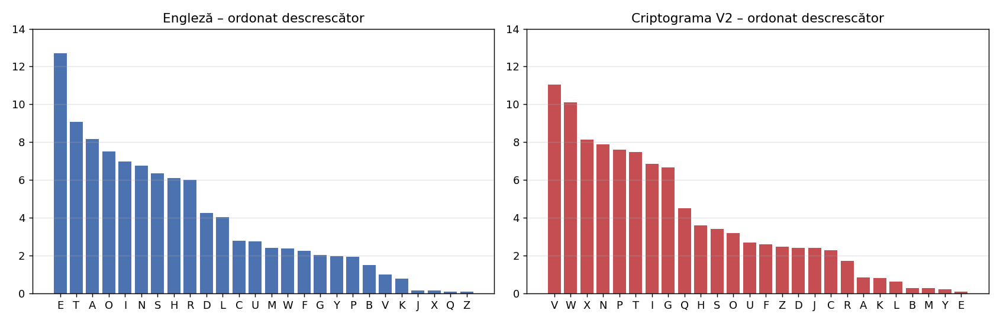
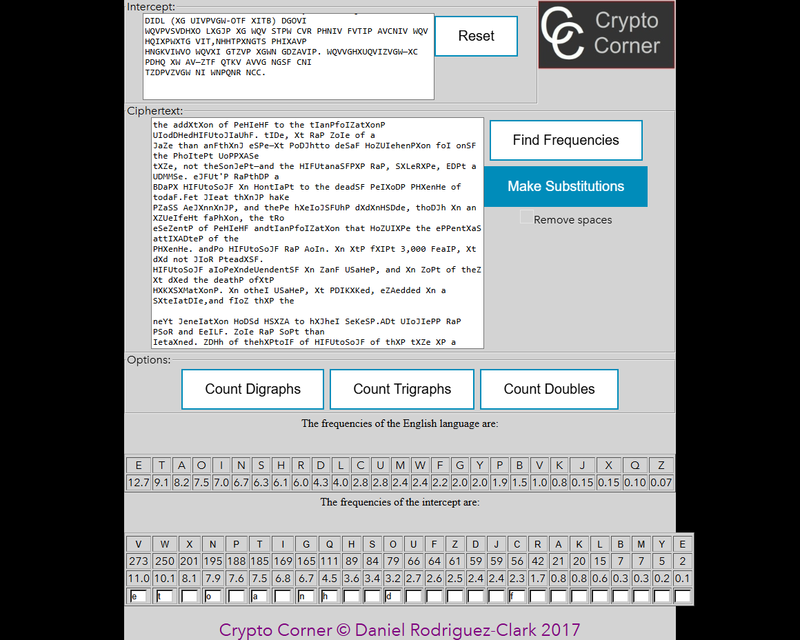
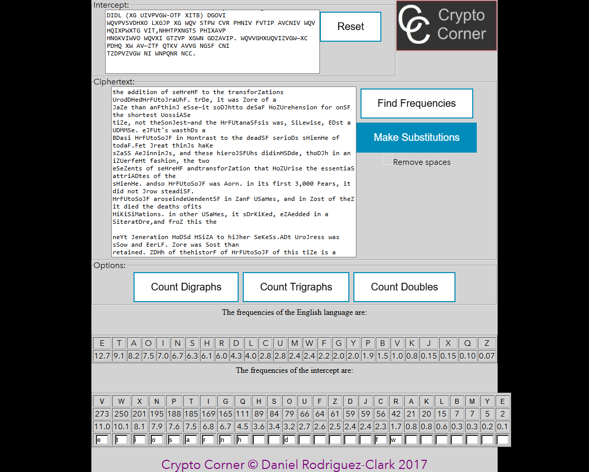

# 1. Scopul lucrării

Spargerea unei criptograme obținute cu un cifru de substituție monoalfabetic, aplicând atacul prin analiza frecvenței literelor, presupunând că textul clar este scris în limba engleză. Au fost criptate doar literele; celelalte caractere au rămas necriptate.

**Varianta.** Numărul meu de ordine în lista grupei este 25, iar lucrarea conține 23 de variante; numerotarea s-a reluat de la început (25 − 23 = 2), deci a fost rezolvată **varianta V2**.

# 2. Noțiuni teoretice

Un cifru monoalfabetic înlocuiește fiecare literă a alfabetului cu aceeași literă a alfabetului criptat (o permutare a alfabetului). Spațiul cheilor este mare (26! ≈ 4·10^26), deci căutarea exhaustivă este imposibilă, însă frecvența literelor din textul clar se păstrează în criptogramă: litera cea mai frecventă din criptogramă corespunde, foarte probabil, uneia dintre cele mai frecvente litere ale limbii (în engleză E 12,7%, T 9,06%, A 8,17%, O 7,51%, I 6,97%, N 6,75% …).

Pe lângă frecvența literelor individuale se folosesc:

- cuvintele scurte: singurele cuvinte de o literă sunt „a” și „I”; cele mai frecvente cuvinte sunt THE, OF, AND, TO, IN, IS, IT, WAS;
- digrafele (TH, HE, AN, IN, ER, ON, RE, ED …), trigrafele (THE, AND, THA, ENT, ION …) și literele duble (SS, EE, TT, OO, FF);
- cuvintele parțial descifrate, care pot fi completate după sens.

# 3. Criptograma interceptată (V2)

```text
Wqv tooxwxng nc pvhivhf wn wqv witgpcniztwxngp uinodhvohifuwnjituqf. Widv, xw rtp zniv nc t 
jtzv wqtg tgfwqxgj vspv—xw pndjqwwn ovstf hnzuivqvgpxng cni ngsf wqv pqniwvpw unppxasv 
wxzv, gnw wqvsngjvpw—tgo wqv hifuwtgtsfpxp rtp, sxlvrxpv, edpw t udmmsv. Vjfuw'p rtpwqdp t 
bdtpx hifuwnsnjf xg hngwitpw wn wqv ovtosf pvixndp phxvghv nc wnotf.Fvw jivtw wqxgjp qtkv 
pztss avjxggxgjp, tgo wqvpv qxvinjsfuqp oxoxghsdov, wqndjq xg tg xzuvicvhw ctpqxng, wqv wrn 
vsvzvgwp nc pvhivhf tgowitgpcniztwxng wqtw hnzuixpv wqv vppvgwxts twwixadwvp nc wqv 
phxvghv. Tgopn hifuwnsnjf rtp anig. Xg xwp cxipw 3,000 fvtip, xw oxo gnw jinr pwvtoxsf. 
Hifuwnsnjf tinpvxgovuvgovgwsf xg ztgf usthvp, tgo xg znpw nc wqvz xw oxvo wqv ovtwqp ncxwp 
hxkxsxmtwxngp. Xg nwqvi usthvp, xw pdikxkvo, vzavoovo xg t sxwvitwdiv,tgo cinz wqxp wqv 

gvyw jvgvitwxng hndso hsxza wn qxjqvi svkvsp.Adw uinjivpp rtp psnr tgo evilf. Zniv rtp snpw wqtg 
ivwtxgvo. Zdhq nc wqvqxpwnif nc hifuwnsnjf nc wqxp wxzv xp t utwhqrnil, t hitmf bdxsw 
ncdgivstwvo xwvzp, puindwxgj, csndixpqxgj, rxwqvixgj. Ngsf wnrtio wqvRvpwvig Ivgtxpptghv 
onvp wqv thhivwxgj lgnrsvojv avjxg wn adxso du tznzvgwdz. Wqv pwnif nc hifuwnsnjf odixgj 
wqvpv fvtip xp, xg nwqvi rniop,vythwsf wqv pwnif nc ztglxgo. Hqxgt, wqv ngsf qxjq hxkxsxmtwxng 
nc tgwxbdxwf wn dpv xovnjituqxhrixwxgj, pvvzp gvkvi wn qtkv ovkvsnuvo zdhq ivts hifuwnjituqf 
—uviqtup cni wqtw ivtpng. Xg ngv htpv lgnrg cni zxsxwtif udiunpvp, wqv11wq-hvgwdif 
hnzuxstwxng, Rd-hqxgj wpdgj-ftn ("Vppvgwxtsp cinz ZxsxwtifHstppxhp"), ivhnzzvgovo t widv xc 
pztss hnov. Wn t sxpw nc 40 ustxgwvywxwvzp, itgjxgj cinz ivbdvpwp cni anrp tgo tiinrp wn wqv 
ivuniw nc tkxhwnif, wqv hniivpungovgwp rndso tppxjg wqv cxipw 40 xovnjitzp nc tunvz. Wqvg, 
rqvg t sxvdwvgtgw rxpqvo, cni vytzusv, wn ivbdvpw znivtiinrp, qv rtp wn Rixwv wqv hniivpungoxgj 
xovnjitz tw t puvhxcxvo usthvng tg nioxgtif oxputwhq tgo pwtzu qxp pvts ng xw.Xg Hqxgt'p jivtw 
gvxjqani wn wqv rvpw, Xgoxt, rqnpv hxkxsxmtwxngsxlvrxpv ovkvsnuvo vtisf tgo wn qxjq vpwtwv, 
pvkvits cnizp nc pvhivwhnzzdgxhtwxngp rviv lgnrg tgo,  t Uutivgwsf, uithwxhvo. Wqv Tiwqt-ptpwit, 
t hstppxh rnil ng pwtwvhitcw twwixadwvo wn Ltdwxsft, xg ovphixaxgjwqv vpuxngtjv pvikxhv nc 
Xgoxt tp uithwxhtssf ixoosxgj wqv hndgwif rxwqp Uxvp, ivhnzzvgovo wqtw wqv nccxhvip nc wqv 
xgpwxwdwvp nc  £ puxngtjv jxkvwqvxi puxvp wqvxi tppxjgzvgwp af pvhivw rixwxgj.Uviqtup znpw 
xgwvivpwxgj wn hifuwnsnjxpwp, tztwvdi niuincvppxngts, xp wqtw Ktwpftftgt'p ctzndp wvywannl 
nc vinwxhp, wqv Ltztpdwit,sxpwp pvhivw rixwxgj tp ngv nc wqv 64 tiwp, ni fnjtp, wqtw rnzvgpqndso 
lgnr tgo uithwxhv. Wqv cndiwq jivtw hxkxsxmtwxng nc tgwxbdxwf, wqvZvpnun-wtzxtg, itwqvi 
utitssvsvo Vjfuw vtisf xg xwp hifuwnjituqxhvknsdwxng, adw wqvg pdiutppvo xw. Wqdp, xg wqv 
stpw uvixno nc hdgvxcnizrixwxgj, xg hnsnuqngp rixwwvg tw Didl (xg uivpvgw-otf Xitb) dgovi 
wqvPvsvdhxo lxgjp xg wqv stpw cvr phniv fvtip avcniv wqv Hqixpwxtg vit,nhhtpxngts phixavp 
hngkviwvo wqvxi gtzvp xgwn gdzavip. Wqvvghxuqvizvgw—xc pdhq xw av—ztf qtkv avvg ngsf cni 
tzdpvzvgw ni wnpqnr ncc.
```

# 4. Procesul de spargere

Am urmat metodologia din compartimentul 2.3. Calculele au fost făcute în serviciul recomandat Crypto Corner (https://crypto.interactive-maths.com/frequency-analysis-breaking-the-code.html) și verificate cu scriptul propriu `frequency_attack.py`, care produce aceleași frecvențe, graficele și textul după fiecare pas. Convenție: literele încă necunoscute sunt scrise cu **MAJUSCULE**, iar cele deja descifrate cu **minuscule**.

## 4.1 Frecvența literelor în criptogramă

Criptograma conține 2473 de litere. Frecvențele, în ordine alfabetică:

| Literă | A | B | C | D | E | F | G | H | I | J | K | L | M | N | O | P | Q | R | S | T | U | V | W | X | Y | Z |
|---|---|---|---|---|---|---|---|---|---|---|---|---|---|---|---|---|---|---|---|---|---|---|---|---|---|---|
| Nr. | 21 | 7 | 56 | 59 | 2 | 64 | 165 | 89 | 169 | 59 | 20 | 15 | 7 | 195 | 79 | 188 | 111 | 42 | 84 | 185 | 66 | 273 | 250 | 201 | 5 | 61 |
| % | 0,85 | 0,28 | 2,26 | 2,39 | 0,08 | 2,59 | 6,67 | 3,60 | 6,83 | 2,39 | 0,81 | 0,61 | 0,28 | 7,89 | 3,19 | 7,60 | 4,49 | 1,70 | 3,40 | 7,48 | 2,67 | 11,04 | 10,11 | 8,13 | 0,20 | 2,47 |

Ordonate descrescător:

| Literă | V | W | X | N | P | T | I | G | Q | H | S | O | U | F | Z | D | J | C | R | A | K | L | B | M | Y | E |
|---|---|---|---|---|---|---|---|---|---|---|---|---|---|---|---|---|---|---|---|---|---|---|---|---|---|---|
| % | 11,04 | 10,11 | 8,13 | 7,89 | 7,60 | 7,48 | 6,83 | 6,67 | 4,49 | 3,60 | 3,40 | 3,19 | 2,67 | 2,59 | 2,47 | 2,39 | 2,39 | 2,26 | 1,70 | 0,85 | 0,81 | 0,61 | 0,28 | 0,28 | 0,20 | 0,08 |







Cele mai frecvente „cuvinte” din criptogramă sunt de mare ajutor:

| Cuvânt | WQV | NC | XG | WN | T | TGO | XW | RTP | CNI | HIFUWNSNJF | WQTW | NGSF |
|---|---|---|---|---|---|---|---|---|---|---|---|---|
| Apariții | 30 | 23 | 16 | 14 | 12 | 10 | 8 | 6 | 6 | 5 | 5 | 4 |

## 4.2 Substituțiile, pas cu pas

### Pasul 1: V → e, W → t

Cele mai frecvente litere din criptogramă sunt V (11,04%) și W (10,11%); în engleză cele mai frecvente sunt E (12,70%) și T (9,06%). Presupunem V→e, W→t.

După substituire (primele rânduri; textul complet al fiecărui pas este în `attack_steps.md`):

```text
tQe TOOXtXNG NC PeHIeHF tN tQe tITGPCNIZTtXNGP UINODHeOHIFUtNJITUQF. tIDe, Xt RTP ZNIe NC T 
JTZe tQTG TGFtQXGJ eSPe—Xt PNDJQttN OeSTF HNZUIeQeGPXNG CNI NGSF tQe PQNItePt UNPPXASe 
tXZe, GNt tQeSNGJePt—TGO tQe HIFUtTGTSFPXP RTP, SXLeRXPe, EDPt T UDMMSe. eJFUt'P RTPtQDP T 
BDTPX HIFUtNSNJF XG HNGtITPt tN tQe OeTOSF PeIXNDP PHXeGHe NC tNOTF.Fet JIeTt tQXGJP QTKe 
PZTSS AeJXGGXGJP, TGO tQePe QXeINJSFUQP OXOXGHSDOe, tQNDJQ XG TG XZUeICeHt CTPQXNG, tQe tRN 
eSeZeGtP NC PeHIeHF TGOtITGPCNIZTtXNG tQTt HNZUIXPe tQe ePPeGtXTS TttIXADteP NC tQe 
```


### Pasul 2: Q → h

Cel mai frecvent cuvânt din text este „tQe” (30 de apariții) – cel mai frecvent cuvânt de 3 litere din engleză este „the”, deci Q→h. Confirmare: Q are 4,49%, iar H în engleză 6,09%, iar digraful TH este cel mai frecvent.

După substituire (primele rânduri; textul complet al fiecărui pas este în `attack_steps.md`):

```text
the TOOXtXNG NC PeHIeHF tN the tITGPCNIZTtXNGP UINODHeOHIFUtNJITUhF. tIDe, Xt RTP ZNIe NC T 
JTZe thTG TGFthXGJ eSPe—Xt PNDJhttN OeSTF HNZUIeheGPXNG CNI NGSF the PhNItePt UNPPXASe 
tXZe, GNt theSNGJePt—TGO the HIFUtTGTSFPXP RTP, SXLeRXPe, EDPt T UDMMSe. eJFUt'P RTPthDP T 
BDTPX HIFUtNSNJF XG HNGtITPt tN the OeTOSF PeIXNDP PHXeGHe NC tNOTF.Fet JIeTt thXGJP hTKe 
PZTSS AeJXGGXGJP, TGO thePe hXeINJSFUhP OXOXGHSDOe, thNDJh XG TG XZUeICeHt CTPhXNG, the tRN 
eSeZeGtP NC PeHIeHF TGOtITGPCNIZTtXNG thTt HNZUIXPe the ePPeGtXTS TttIXADteP NC the 
```


### Pasul 3: T → a, G → n, O → d

Cuvântul dintr-o singură literă „T” apare de 12 ori – în engleză doar „a” și „I” sunt cuvinte de o literă; deoarece apare și în „thTt” → „tha?” (that) și „thTG” → „than”, T→a. Cuvântul „TGO” apare de 10 ori: „a??” frecvent = „and”, deci G→n, O→d.

După substituire (primele rânduri; textul complet al fiecărui pas este în `attack_steps.md`):

```text
the addXtXNn NC PeHIeHF tN the tIanPCNIZatXNnP UINdDHedHIFUtNJIaUhF. tIDe, Xt RaP ZNIe NC a 
JaZe than anFthXnJ eSPe—Xt PNDJhttN deSaF HNZUIehenPXNn CNI NnSF the PhNItePt UNPPXASe 
tXZe, nNt theSNnJePt—and the HIFUtanaSFPXP RaP, SXLeRXPe, EDPt a UDMMSe. eJFUt'P RaPthDP a 
BDaPX HIFUtNSNJF Xn HNntIaPt tN the deadSF PeIXNDP PHXenHe NC tNdaF.Fet JIeat thXnJP haKe 
PZaSS AeJXnnXnJP, and thePe hXeINJSFUhP dXdXnHSDde, thNDJh Xn an XZUeICeHt CaPhXNn, the tRN 
eSeZentP NC PeHIeHF andtIanPCNIZatXNn that HNZUIXPe the ePPentXaS attIXADteP NC the 
```


### Pasul 4: N → o, C → f

Cuvântul „WN” = „tN” apare de 14 ori → „to”, deci N→o. Cuvântul de 2 litere „NC” = „oC” este al doilea cel mai frecvent cuvânt (23 de apariții) → „of”, deci C→f.

După substituire (primele rânduri; textul complet al fiecărui pas este în `attack_steps.md`):

```text
the addXtXon of PeHIeHF to the tIanPfoIZatXonP UIodDHedHIFUtoJIaUhF. tIDe, Xt RaP ZoIe of a 
JaZe than anFthXnJ eSPe—Xt PoDJhtto deSaF HoZUIehenPXon foI onSF the PhoItePt UoPPXASe 
tXZe, not theSonJePt—and the HIFUtanaSFPXP RaP, SXLeRXPe, EDPt a UDMMSe. eJFUt'P RaPthDP a 
BDaPX HIFUtoSoJF Xn HontIaPt to the deadSF PeIXoDP PHXenHe of todaF.Fet JIeat thXnJP haKe 
PZaSS AeJXnnXnJP, and thePe hXeIoJSFUhP dXdXnHSDde, thoDJh Xn an XZUeIfeHt faPhXon, the tRo 
eSeZentP of PeHIeHF andtIanPfoIZatXon that HoZUIXPe the ePPentXaS attIXADteP of the 
```



### Pasul 5: X → i, P → s

Cuvintele „XG” = „Xn” (16 apariții) și „XW” = „Xt” (8 apariții) → „in”, „it”, deci X→i. Atunci „XP” → „iP” = „is”, iar „RaP”, „thXnJP” (plural cu -s) confirmă P→s.

După substituire (primele rânduri; textul complet al fiecărui pas este în `attack_steps.md`):

```text
the addition of seHIeHF to the tIansfoIZations UIodDHedHIFUtoJIaUhF. tIDe, it Ras ZoIe of a 
JaZe than anFthinJ eSse—it soDJhtto deSaF HoZUIehension foI onSF the shoItest UossiASe 
tiZe, not theSonJest—and the HIFUtanaSFsis Ras, SiLeRise, EDst a UDMMSe. eJFUt's RasthDs a 
BDasi HIFUtoSoJF in HontIast to the deadSF seIioDs sHienHe of todaF.Fet JIeat thinJs haKe 
sZaSS AeJinninJs, and these hieIoJSFUhs didinHSDde, thoDJh in an iZUeIfeHt fashion, the tRo 
eSeZents of seHIeHF andtIansfoIZation that HoZUIise the essentiaS attIiADtes of the 
```


### Pasul 6: R → w, I → r

„Ras” (6 apariții) → „was”, deci R→w. „foI” (6 apariții) → „for”, deci I→r; confirmă și „tIansfoIZations” → „transformations”.

După substituire (primele rânduri; textul complet al fiecărui pas este în `attack_steps.md`):

```text
the addition of seHreHF to the transforZations UrodDHedHrFUtoJraUhF. trDe, it was Zore of a 
JaZe than anFthinJ eSse—it soDJhtto deSaF HoZUrehension for onSF the shortest UossiASe 
tiZe, not theSonJest—and the HrFUtanaSFsis was, SiLewise, EDst a UDMMSe. eJFUt's wasthDs a 
BDasi HrFUtoSoJF in Hontrast to the deadSF serioDs sHienHe of todaF.Fet Jreat thinJs haKe 
sZaSS AeJinninJs, and these hieroJSFUhs didinHSDde, thoDJh in an iZUerfeHt fashion, the two 
eSeZents of seHreHF andtransforZation that HoZUrise the essentiaS attriADtes of the 
```



### Pasul 7: H → c, F → y, U → p, S → l, J → g

Cuvântul „HrFUtoSoJF” apare de 5 ori – tema textului (istoria criptografiei) sugerează „cryptology”: H→c, F→y, U→p, S→l, J→g. Confirmă și „onSF” → „only”, „Jreat” → „great”, „thinJs” → „things”.

După substituire (primele rânduri; textul complet al fiecărui pas este în `attack_steps.md`):

```text
the addition of secrecy to the transforZations prodDcedcryptography. trDe, it was Zore of a 
gaZe than anything else—it soDghtto delay coZprehension for only the shortest possiAle 
tiZe, not thelongest—and the cryptanalysis was, liLewise, EDst a pDMMle. egypt's wasthDs a 
BDasi cryptology in contrast to the deadly serioDs science of today.yet great things haKe 
sZall Aeginnings, and these hieroglyphs didinclDde, thoDgh in an iZperfect fashion, the two 
eleZents of secrecy andtransforZation that coZprise the essential attriADtes of the 
```


### Pasul 8: Z → m, K → v, D → u

„Zore” → „more”, „tiZe” → „time”, deci Z→m. „haKe” (3 apariții) → „have”, deci K→v. „trDe” → „true”, „soDght” → „sought”, deci D→u.

După substituire (primele rânduri; textul complet al fiecărui pas este în `attack_steps.md`):

```text
the addition of secrecy to the transformations producedcryptography. true, it was more of a 
game than anything else—it soughtto delay comprehension for only the shortest possiAle 
time, not thelongest—and the cryptanalysis was, liLewise, Eust a puMMle. egypt's wasthus a 
Buasi cryptology in contrast to the deadly serious science of today.yet great things have 
small Aeginnings, and these hieroglyphs didinclude, though in an imperfect fashion, the two 
elements of secrecy andtransformation that comprise the essential attriAutes of the 
```


### Pasul 9: A → b, L → k, M → z, B → q, Y → x, E → j

Literele rare rămase rezultă din cuvinte aproape descifrate: „Aeginnings” → „beginnings” (A→b), „Lnown” → „known” (L→k), „puMMle” → „puzzle” (M→z), „Buasi” → „quasi” (B→q), „eYactly”, „neYt” → „exactly”, „next” (Y→x), „Eust” → „just” (E→j).

După substituire (primele rânduri; textul complet al fiecărui pas este în `attack_steps.md`):

```text
the addition of secrecy to the transformations producedcryptography. true, it was more of a 
game than anything else—it soughtto delay comprehension for only the shortest possible 
time, not thelongest—and the cryptanalysis was, likewise, just a puzzle. egypt's wasthus a 
quasi cryptology in contrast to the deadly serious science of today.yet great things have 
small beginnings, and these hieroglyphs didinclude, though in an imperfect fashion, the two 
elements of secrecy andtransformation that comprise the essential attributes of the 
```


## 4.3 Cheia reconstituită

Alăturând alfabetul textului clar și alfabetul criptogramei obținem cheia folosită la criptare:

| Text clar | a | b | c | d | e | f | g | h | i | j | k | l | m | n | o | p | q | r | s | t | u | v | w | x | y | z |
|---|---|---|---|---|---|---|---|---|---|---|---|---|---|---|---|---|---|---|---|---|---|---|---|---|---|---|
| Criptogramă | T | A | H | O | V | C | J | Q | X | E | L | S | Z | G | N | U | B | I | P | W | D | K | R | Y | F | M |

Toate cele 26 de litere sunt distincte, deci cheia este o permutare validă. Cheia coincide cu cea din varianta V1 (de exemplu „wqv” = „the” și acolo), lucru firesc: V1 și V2 sunt fragmente consecutive din același text, criptate cu aceeași cheie — exact situația descrisă în lucrare, când aceeași persoană refolosește cheia.

# 5. Mesajul decriptat

```text
The addition of secrecy to the transformations producedcryptography. True, it was more of a 
game than anything else—it soughtto delay comprehension for only the shortest possible 
time, not thelongest—and the cryptanalysis was, likewise, just a puzzle. Egypt's wasthus a 
quasi cryptology in contrast to the deadly serious science of today.Yet great things have 
small beginnings, and these hieroglyphs didinclude, though in an imperfect fashion, the two 
elements of secrecy andtransformation that comprise the essential attributes of the 
science. Andso cryptology was born. In its first 3,000 years, it did not grow steadily. 
Cryptology aroseindependently in many places, and in most of them it died the deaths ofits 
civilizations. In other places, it survived, embedded in a literature,and from this the 

next generation could climb to higher levels.But progress was slow and jerky. More was lost than 
retained. Much of thehistory of cryptology of this time is a patchwork, a crazy quilt 
ofunrelated items, sprouting, flourishing, withering. Only toward theWestern Renaissance 
does the accreting knowledge begin to build up amomentum. The story of cryptology during 
these years is, in other words,exactly the story of mankind. China, the only high civilization 
of antiquity to use ideographicwriting, seems never to have developed much real cryptography 
—perhaps for that reason. In one case known for military purposes, the11th-century 
compilation, Wu-ching tsung-yao ("Essentials from MilitaryClassics"), recommended a true if 
small code. To a list of 40 plaintextitems, ranging from requests for bows and arrows to the 
report of avictory, the correspondents would assign the first 40 ideograms of apoem. Then, 
when a lieutenant wished, for example, to request morearrows, he was to Write the corresponding 
ideogram at a specified placeon an ordinary dispatch and stamp his seal on it.In China's great 
neighbor to the west, India, whose civilizationlikewise developed early and to high estate, 
several forms of secretcommunications were known and,  a Pparently, practiced. The Artha-sastra, 
a classic work on statecraft attributed to Kautilya, in describingthe espionage service of 
India as practically riddling the country withs Pies, recommended that the officers of the 
institutes of  £ spionage givetheir spies their assignments by secret writing.Perhaps most 
interesting to cryptologists, amateur orprofessional, is that Vatsyayana's famous textbook 
of erotics, the Kamasutra,lists secret writing as one of the 64 arts, or yogas, that womenshould 
know and practice. The fourth great civilization of antiquity, theMesopo-tamian, rather 
paralleled Egypt early in its cryptographicevolution, but then surpassed it. Thus, in the 
last period of cuneiformwriting, in colophons written at Uruk (in present-day Iraq) under 
theSeleucid kings in the last few score years before the Christian era,occasional scribes 
converted their names into numbers. Theencipherment—if such it be—may have been only for 
amusement or toshow off.
```

Textul este un fragment din cartea lui David Kahn „The Codebreakers” (capitolul despre începuturile criptologiei: Egipt, China, India, Mesopotamia). Unele cuvinte apar lipite (de ex. „producedcryptography”) sau cu caractere ciudate („£ spionage”, „a Pparently”): acestea sunt prezente chiar în criptograma din enunț (spațiile și simbolurile nu au fost criptate), deci nu sunt erori de decriptare.

# 6. Concluzii

Deși cifrul monoalfabetic are 26! chei, el a fost spart în 9 pași doar pe baza statisticii limbii engleze: frecvența literelor a dat primele două substituții (V→e, W→t), iar cuvintele scurte foarte frecvente (THE, A, AND, TO, OF, IN, WAS, FOR) au fixat încă 10 litere. După aceea textul a devenit suficient de lizibil pentru ca restul literelor, inclusiv cele rare (Q, X, J, Z, K), să fie deduse din sensul cuvintelor. Atacul a mers ușor deoarece textul este lung (2473 de litere), iar spațiile și punctuația au rămas necriptate și dezvăluie lungimea cuvintelor. Am învățat că un spațiu mare al cheilor nu garantează securitatea, dacă cifrul păstrează structura statistică a textului clar, și că analiza frecvențelor are nevoie de judecata omului, nu doar de ordonarea literelor după frecvență: ordonarea directă (V W X N P T I G … → e t a o i n s h …) ar fi dat greșit X→a, P→i, T→n, în loc de X→i, P→s, T→a.

# 7. Codul sursă

Depozitul GitHub (ramura `Cripto`): https://github.com/mihaizastinceanu/Cripto/tree/Cripto/lab2

- `frequency_attack.py` – frecvențe, grafice, pașii atacului, cheia și textul decriptat;
- `site_screens.py` – reproduce pașii în Crypto Corner și salvează capturile de ecran;
- `ciphertext_v2.txt`, `plaintext_v2.txt`, `attack_steps.md` – datele și rezultatele complete.
