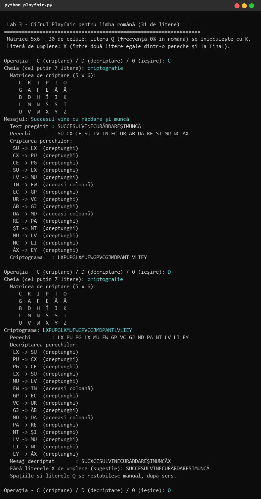
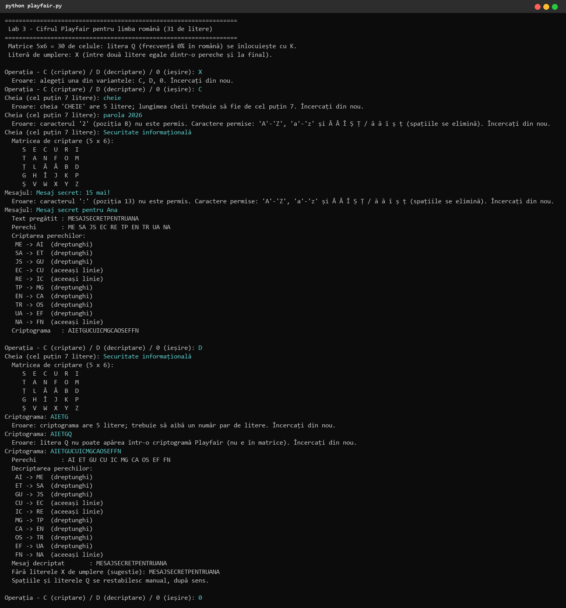

# 1. Sarcina

Numărul meu de ordine în registrul grupei este 25 (impar), deci am realizat **Sarcina 3.1**: implementarea algoritmului **Playfair** pentru mesaje în limba română (31 de litere). Cerințe: textul poate conține doar literele alfabetului (majuscule sau minuscule), în caz contrar utilizatorului i se arată diapazonul corect; cheia are cel puțin 7 litere; utilizatorul alege operația (criptare/decriptare), introduce cheia și mesajul/criptograma și obține rezultatul; adăugarea spațiilor după decriptare se face manual.

# 2. Noțiuni teoretice

**Cifrurile polialfabetice** schimbă substituția unui caracter în funcție de poziție sau context, astfel încât distribuția frecvențelor din criptogramă devine mai uniformă decât la cifrurile monoalfabetice (Lab 2). Exemplul clasic este cifrul **Vigenère**: c_i = (m_i + k_i) mod n, m_i = (c_i − k_i) mod n, unde cheia se repetă periodic.

**Cifrul Playfair** (Ch. Wheatstone, 1854) criptează **perechi de litere** (digrame) cu ajutorul unei matrice construite din cheie, fiind unul dintre primii algoritmi care folosesc ideea cifrurilor bloc. Aceeași literă este criptată diferit în funcție de litera cu care formează pereche.

Pașii algoritmului:

1. **Pregătirea textului:** majuscule, fără spații și punctuație; textul se împarte în perechi; dacă o pereche are două litere egale, între ele se inserează o literă rară (X); dacă rămâne o literă fără pereche, se adaugă la sfârșit o literă de umplere.
2. **Construirea matricei:** se scriu pe linii literele cheii fără repetări, apoi restul literelor alfabetului în ordine.
3. **Criptarea fiecărei perechi:**
   - litere pe linii și coloane diferite (dreptunghi) → fiecare literă se înlocuiește cu litera de pe aceeași linie, dar din coloana celeilalte litere;
   - litere pe aceeași linie → fiecare se înlocuiește cu litera din dreapta (circular);
   - litere pe aceeași coloană → fiecare se înlocuiește cu litera de dedesubt (circular).
4. **Decriptarea** aplică aceleași reguli în sens invers: dreptunghiul rămâne la fel, pe linie se ia litera din stânga, pe coloană litera de deasupra. Literele X de umplere și spațiile se elimină/adaugă manual, după sens.

## 2.1 Adaptarea pentru limba română

Alfabetul român are 31 de litere: A Ă Â B C D E F G H I Î J K L M N O P Q R S Ș T Ț U V W X Y Z. Am ales o matrice de **5 linii × 6 coloane = 30 de celule**, deci, ca în varianta engleză (unde J se înlocuiește cu I), o literă este eliminată: **Q**, care are frecvența 0,00% în limba română (tabelul 2.1 din Lab 2) și apare doar în cuvinte străine. Q se înlocuiește cu **K** (același sunet), iar la decriptare se restabilește intuitiv. Varianta cu o matrice 6×6 ar fi lăsat 5 celule libere completate cu simboluri, care ar fi apărut în criptogramă — de aceea nu am folosit-o. Litera de umplere este **X** (frecvență 0,11% în română); dacă litera dublată este chiar X, se folosește Y.

# 3. Implementarea

Programul este scris în Python 3: `lab3/playfair.py`.

## 3.1 Alfabetul și validarea textului

```python
ALPHABET = ["A", "Ă", "Â", "B", "C", "D", "E", "F", "G", "H", "I", "Î", "J", "K", "L", "M",
            "N", "O", "P", "Q", "R", "S", "Ș", "T", "Ț", "U", "V", "W", "X", "Y", "Z"]
ROWS, COLS = 5, 6
DROPPED, REPLACEMENT = "Q", "K"
MATRIX_LETTERS = [ch for ch in ALPHABET if ch != DROPPED]          # 30 letters

def normalize(text: str) -> str:
    out = []
    for pos, ch in enumerate(text, 1):
        if ch == " ":
            continue
        if ch not in UPPER:
            raise InputError(f"caracterul '{ch}' (poziția {pos}) nu este permis. "
                             f"Caractere permise: {ALLOWED}.")
        out.append(UPPER[ch])
    ...
```

`UPPER` conține toate caracterele acceptate (minuscule, majuscule, inclusiv variantele cu sedilă Ş/Ţ) și forma lor majusculă. Spațiile se elimină, iar la primul caracter nepermis programul afișează caracterul, poziția și diapazonul corect, apoi cere din nou datele. Cheia trece prin aceeași validare și trebuie să aibă cel puțin 7 litere.

## 3.2 Construirea matricei

```python
def build_matrix(key: str) -> list[list[str]]:
    seen = []
    for ch in key.replace(DROPPED, REPLACEMENT) + "".join(MATRIX_LETTERS):
        if ch not in seen:
            seen.append(ch)
    return [seen[r * COLS:(r + 1) * COLS] for r in range(ROWS)]
```

Literele cheii (cu Q → K) sunt urmate de tot alfabetul; se păstrează doar prima apariție a fiecărei litere, apoi lista de 30 de litere se taie în 5 linii a câte 6.

## 3.3 Pregătirea textului (perechi și litere de umplere)

```python
def prepare(text: str) -> list[str]:
    text = text.replace(DROPPED, REPLACEMENT)
    pairs, i = [], 0
    while i < len(text):
        a = text[i]
        b = text[i + 1] if i + 1 < len(text) else None
        if b is None:                      # last letter without pair -> pad
            pairs.append(a + (FILLER if a != FILLER else FILLER2)); i += 1
        elif a == b:                       # double letter in a pair -> insert X
            pairs.append(a + (FILLER if a != FILLER else FILLER2)); i += 1
        else:
            pairs.append(a + b); i += 2
    return pairs
```

Textul este parcurs de la stânga la dreapta; dacă cele două litere ale perechii curente sunt egale, perechea devine „literă + X”, iar a doua literă începe perechea următoare (de exemplu SUCCESUL → SU CX CE SU L…).

## 3.4 Criptarea și decriptarea unei perechi

```python
def transform_pair(pair, pos, matrix, step):       # step = +1 criptare, -1 decriptare
    (r1, c1), (r2, c2) = pos[pair[0]], pos[pair[1]]
    if r1 == r2:                                    # aceeași linie -> dreapta / stânga
        return matrix[r1][(c1 + step) % COLS] + matrix[r2][(c2 + step) % COLS], "aceeași linie"
    if c1 == c2:                                    # aceeași coloană -> jos / sus
        return matrix[(r1 + step) % ROWS][c1] + matrix[(r2 + step) % ROWS][c2], "aceeași coloană"
    return matrix[r1][c2] + matrix[r2][c1], "dreptunghi"
```

O singură funcție implementează ambele operații: parametrul `step` dă direcția de deplasare (+1 la criptare, −1 la decriptare), iar operația `% COLS` / `% ROWS` asigură trecerea circulară de la ultima la prima literă. La regula dreptunghiului, criptarea și decriptarea sunt identice.

La decriptare programul verifică în plus că criptograma are lungime pară, nu conține Q (care nu există în matrice) și nu conține perechi cu două litere egale — astfel de texte nu pot fi produse de Playfair. După decriptare se afișează textul exact și o sugestie fără literele X de umplere; spațiile se adaugă manual.

## 3.5 Verificarea pe exemplul din îndrumar

Cu dimensiunile matricei puse temporar la 5×5 (alfabet englez, J → I), funcția construiește pentru cheia FIRST AMENDMENT exact matricea din îndrumar, iar perechile NP → EQ, IT → RF, CW → OI și începutul criptogramei (CO NG RE SX → OW EH EG RY) coincid cu exemplul. Am verificat și 2000 de mesaje aleatoare: decriptarea urmată de eliminarea literelor de umplere redă mesajul inițial.

# 4. Rezultate

Criptarea mesajului „Succesul vine cu răbdare și muncă” cu cheia „criptografie” și decriptarea criptogramei obținute. Se vede matricea, perechile (SU **CX** CE … — dublura CC a fost despărțită cu X — și **ĂX** la final, pentru lungimea impară) și regula aplicată fiecărei perechi:



Textul decriptat este `SUCXCESULVINECURĂBDAREȘIMUNCĂX`. Eliminând manual literele X de umplere și adăugând spațiile după sens, obținem: **SUCCESUL VINE CU RĂBDARE ȘI MUNCĂ**.

Tratarea datelor greșite: opțiune inexistentă, cheie prea scurtă, cheie cu cifre, mesaj cu „:”, cifre și „!”, criptogramă cu lungime impară, criptogramă cu litera Q; apoi criptare/decriptare corectă cu cheia „Securitate informațională”:



# 5. Concluzii

Cifrul Playfair este mai rezistent decât cifrurile monoalfabetice din Lab 1 și Lab 2, deoarece criptează digrame: aceeași literă se transformă diferit în funcție de vecina ei (de exemplu în demonstrație C devine P în perechea CE, dar G în perechea UC), iar frecvența literelor individuale se aplatizează. Totuși, pentru alfabetul român există doar 30·29 = 870 de digrame posibile, iar o digramă dată se criptează mereu la fel, deci cifrul cedează la analiza frecvenței digramelor dacă textul este suficient de lung; de asemenea, o pereche și inversa ei se criptează simetric (AB → XY implică BA → YX). Adaptarea la limba română a cerut alegerea unei matrice 5×6 și a unei litere eliminate (Q), precum și tratarea literelor cu diacritice. Am învățat cum se construiesc regulile pe linie/coloană/dreptunghi cu aritmetică modulară și de ce etapa finală (eliminarea literelor de umplere și adăugarea spațiilor) necesită intervenția omului.

# 6. Codul sursă

Depozitul GitHub (ramura `Cripto`): https://github.com/mihaizastinceanu/Cripto/tree/Cripto/lab3
