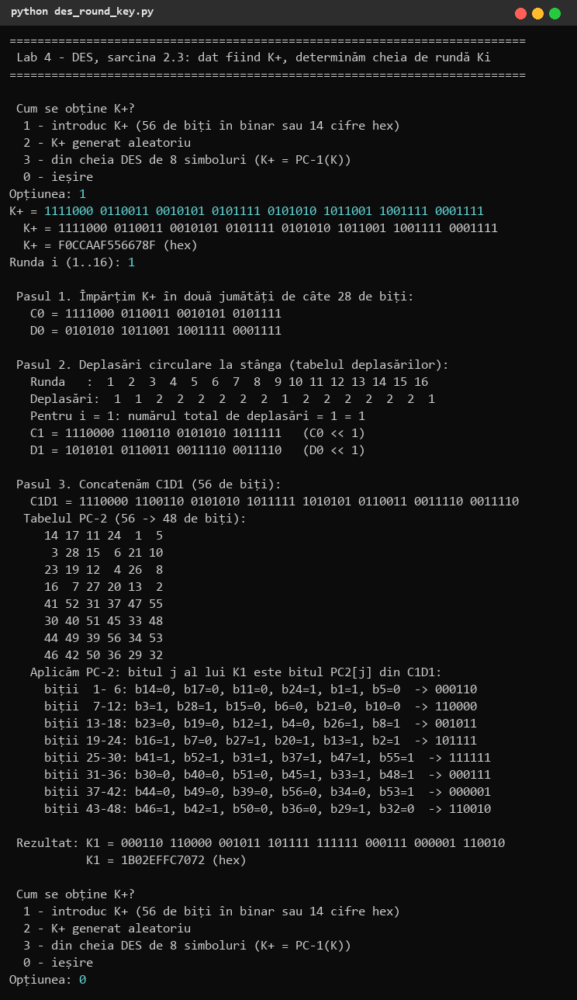
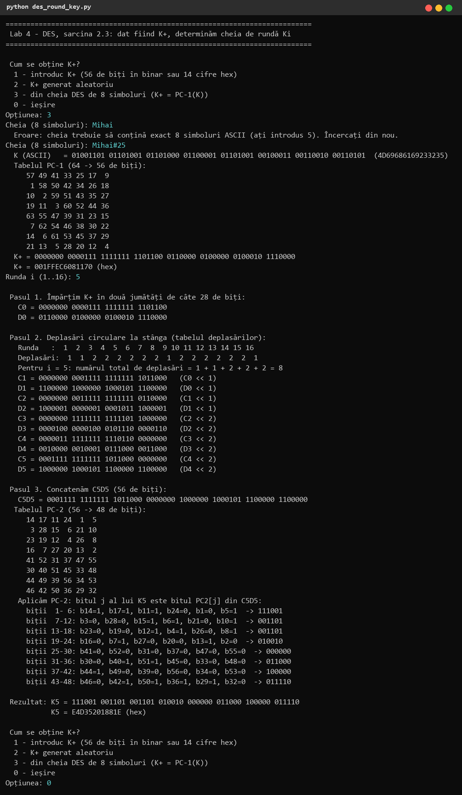
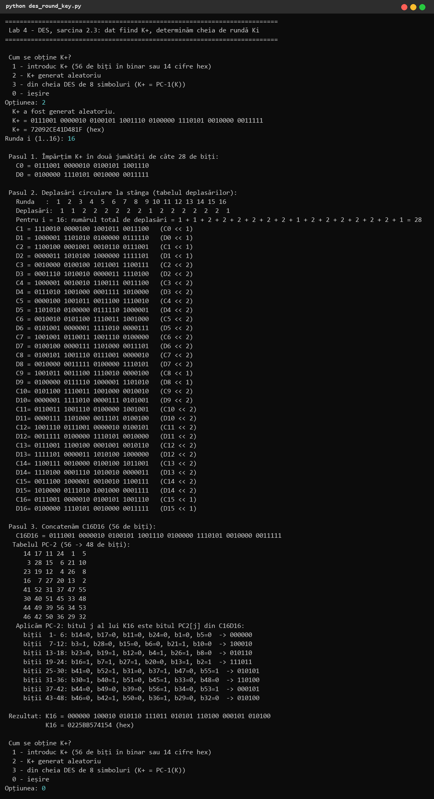
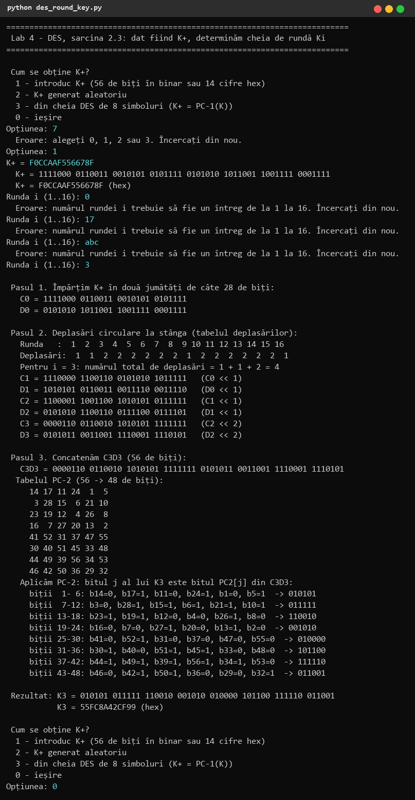

# 1. Sarcina

Numărul meu de ordine în lista grupei este n = 25, deci nr_sarcina = 25 mod 11 = **3**:

> **2.3.** În algoritmul DES este dat K+. Să se determine cheia de rundă Ki pentru un i dat.

Pentru sarcină trebuie afișate tabelele folosite și toți pașii intermediari, iar datele de intrare se pot introduce de utilizator sau genera aleatoriu.

# 2. Noțiuni teoretice: algoritmul DES

**DES** (Data Encryption Standard, FIPS 46, 1977; FIPS 46-3, 1999) este un cifru bloc simetric bazat pe o **rețea Feistel** cu 16 runde. Blocul are 64 de biți, cheia 64 de biți, din care 8 sunt biți de paritate (biții 8, 16, …, 64), deci cheia efectivă are **56 de biți**.

## 2.1 Criptarea unui bloc

1. **Permutarea inițială IP**: blocul M de 64 de biți se permută, apoi se împarte în L0 (32 de biți, stânga) și R0 (32 de biți, dreapta).
2. **16 runde** Feistel, pentru i = 1..16:

        Li = R(i-1)
        Ri = L(i-1) XOR f(R(i-1), Ki)

3. **Funcția f(R, K)**:
   - **expansiunea E**: R (32 de biți) → E(R) (48 de biți), unii biți fiind duplicați;
   - **XOR cu cheia de rundă**: Ki ⊕ E(R) = B1B2…B8 (8 grupuri de câte 6 biți);
   - **cutiile S**: fiecare Bj = b1b2b3b4b5b6 intră în cutia Sj: biții b1b6 dau linia (0..3), biții b2b3b4b5 coloana (0..15), iar valoarea din tabel dă 4 biți; rezultatul are 8·4 = 32 de biți — singura parte neliniară a algoritmului;
   - **permutarea P** a celor 32 de biți.
4. După runda 16 se inversează jumătățile (R16L16) și se aplică **permutarea finală IP⁻¹**, obținându-se criptograma de 64 de biți.

**Decriptarea** folosește același algoritm, cu cheile de rundă în ordine inversă (K16, …, K1) — proprietate a rețelelor Feistel, pentru care f nu trebuie să fie inversabilă.

## 2.2 Generarea cheilor de rundă (subiectul sarcinii 2.3)

1. **PC-1** (Permuted Choice 1): din cheia K de 64 de biți se aleg 56 de biți (se elimină biții de paritate) și se permută: **K+ = PC-1(K)**.
2. K+ se împarte în **C0** (primii 28 de biți) și **D0** (ultimii 28 de biți).
3. Pentru fiecare rundă i, Ci și Di se obțin din C(i−1), D(i−1) prin **deplasare circulară la stânga** cu 1 sau 2 poziții, după tabelul:

   | Runda | 1 | 2 | 3 | 4 | 5 | 6 | 7 | 8 | 9 | 10 | 11 | 12 | 13 | 14 | 15 | 16 |
   |---|---|---|---|---|---|---|---|---|---|---|---|---|---|---|---|---|
   | Deplasări | 1 | 1 | 2 | 2 | 2 | 2 | 2 | 2 | 1 | 2 | 2 | 2 | 2 | 2 | 2 | 1 |

   Suma deplasărilor este 28, deci C16 = C0 și D16 = D0.
4. **PC-2** (Permuted Choice 2): din cei 56 de biți ai lui CiDi se aleg 48 (biții 9, 18, 22, 25, 35, 38, 43, 54 nu sunt folosiți) și se permută: **Ki = PC-2(CiDi)**.

Tabelul PC-2 (bitul j al lui Ki este bitul indicat din CiDi):

    14 17 11 24  1  5
     3 28 15  6 21 10
    23 19 12  4 26  8
    16  7 27 20 13  2
    41 52 31 37 47 55
    30 40 51 45 33 48
    44 49 39 56 34 53
    46 42 50 36 29 32

Prima jumătate a tabelului (rândurile 1–4) folosește doar biți din Ci (1..28), a doua doar biți din Di (29..56).

# 3. Implementarea

Programul `lab4/des_round_key.py` (Python 3) oferă trei moduri de a obține K+: introducere manuală (56 de cifre binare sau 14 cifre hex), generare aleatoare (`secrets.randbits(56)`) sau calcul din cheia DES de 8 simboluri prin PC-1. Apoi utilizatorul introduce runda i (1..16).

```python
SHIFTS = [1, 1, 2, 2, 2, 2, 2, 2, 1, 2, 2, 2, 2, 2, 2, 1]

def permute(bits: str, table: list[int]) -> str:
    """Bit i of the result is bit table[i] of the input (positions start at 1)."""
    return "".join(bits[p - 1] for p in table)

def rotl(bits: str, n: int) -> str:
    return bits[n:] + bits[:n]
```

Biții sunt păstrați ca șir de caractere '0'/'1', ceea ce face ușoară afișarea pașilor. `permute` aplică orice tabel DES (PC-1, PC-2), numerotarea pozițiilor începând de la 1, ca în standard; `rotl` este deplasarea circulară la stânga.

```python
def round_key(k_plus: str, i: int, verbose=True) -> str:
    c, d = k_plus[:28], k_plus[28:]                 # Pasul 1: C0, D0
    for r in range(1, i + 1):                       # Pasul 2: C1D1 ... CiDi
        c, d = rotl(c, SHIFTS[r - 1]), rotl(d, SHIFTS[r - 1])
    cd = c + d
    k = permute(cd, PC2)                            # Pasul 3: Ki = PC-2(CiDi)
    return k
```

(fragment simplificat — programul afișează după fiecare operație valorile intermediare: C0, D0, tabelul deplasărilor, suma deplasărilor până la runda i, toți Cr, Dr pentru r = 1..i, CiDi, tabelul PC-2 și, pentru fiecare grup de 6 biți ai lui Ki, ce biți din CiDi au fost luați).

Validarea datelor: K+ trebuie să aibă exact 56 de biți (56 de cifre binare sau 14 hex), runda — un întreg de la 1 la 16, cheia — exact 8 simboluri ASCII; la eroare se afișează mesajul și se cere din nou valoarea.

**Verificare.** Pentru vectorul de test clasic K = 133457799BBCDFF1 (J. O. Grabbe, „The DES Algorithm Illustrated”), programul obține exact valorile publicate:
K+ = 1111000 0110011 0010101 0101111 0101010 1011001 1001111 0001111,
K1 = 000110 110000 001011 101111 111111 000111 000001 110010,
K3 = 010101 011111 110010 001010 010000 101100 111110 011001,
K16 = 110010 110011 110110 001011 000011 100001 011111 110101.

# 4. Rezultate

**Exemplul 1** — K+ din vectorul de test, i = 1 (rezultatul coincide cu K1 publicat):



**Exemplul 2** — cheia de 8 simboluri „Mihai#25” → K+ prin PC-1, i = 5 (cheia „Mihai” a fost respinsă: 5 simboluri):



Calculul pentru i = 5: numărul total de deplasări este 1 + 1 + 2 + 2 + 2 = 8, deci C5 = C0 rotit cu 8 poziții:
C0 = 0000000 0000111 1111111 1101100 → C5 = 0001111 1111111 1011000 0000000.
Primul grup al lui K5: PC-2 ia biții 14, 17, 11, 24, 1, 5 din C5D5 = 1, 1, 1, 0, 0, 1 → 111001.
Rezultat: **K5 = 111001 001101 001101 010010 000000 011000 100000 011110 = E4D35201881E (hex)**.

**Exemplul 3** — K+ generat aleatoriu, i = 16 (se observă că C16 = C0 și D16 = D0, deoarece suma deplasărilor este 28):



**Exemplul 4** — date greșite (opțiune inexistentă, K+ de 56 de biți scris cu 14 cifre hex acceptat, runde 0, 17 și „abc” respinse), apoi K3 pentru vectorul de test:



# 5. Concluzii

Am implementat generarea cheii de rundă Ki din K+ a algoritmului DES și am verificat-o pe vectorul de test standard. Schema de generare a cheilor este simplă (doar deplasări circulare și permutări fixe), deci fiecare cheie de rundă este o selecție de 48 din cei 56 de biți ai cheii; datorită deplasărilor diferite, fiecare bit al cheii participă în aproximativ 14 din cele 16 runde, în poziții diferite. Securitatea DES vine din combinarea cheilor de rundă cu funcția f (expansiune, XOR, cutii S neliniare, permutare) pe 16 runde Feistel, dar cheia efectivă de 56 de biți (2^56 ≈ 7,2·10^16 chei) este astăzi prea scurtă — DES a fost spart prin forță brută încă din 1998 (EFF „Deep Crack”), motiv pentru care a fost înlocuit de 3DES și apoi de AES. Am înțeles de asemenea de ce decriptarea folosește aceleași chei în ordine inversă și de ce C16D16 = C0D0.

# 6. Codul sursă

Depozitul GitHub (ramura `Cripto`): https://github.com/mihaizastinceanu/Cripto/tree/Cripto/lab4
