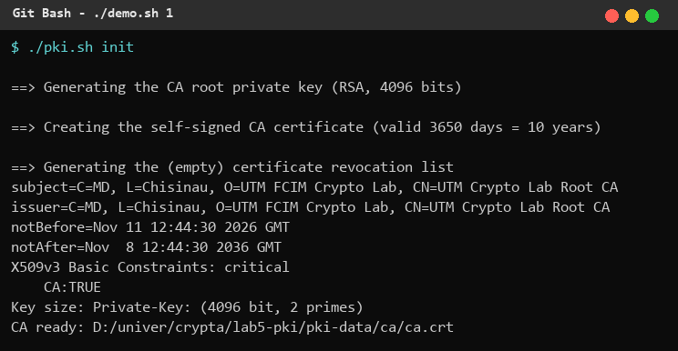
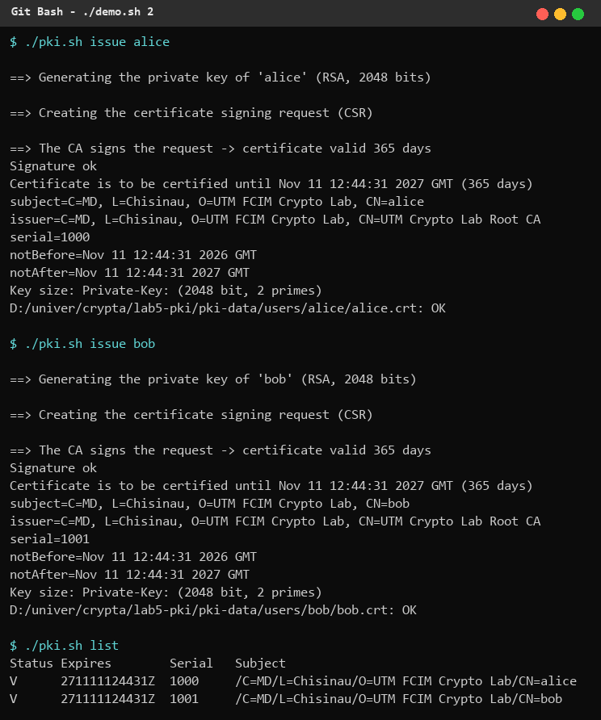
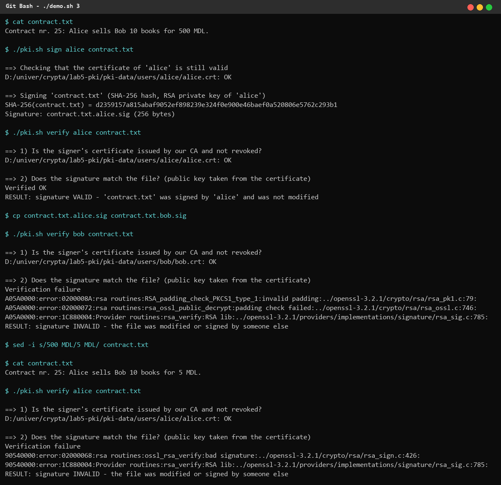
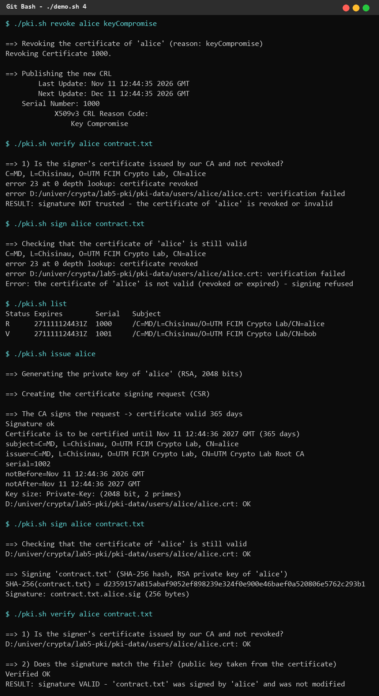

# 1. Task

Create an internal PKI with the OpenSSL tool: generate the root private key and initialise a Certification Authority (CA) with a self-signed certificate. The system must be able to issue and revoke the users' keys/certificates; each user who obtains a certificate can sign a document/file and verify the signature.

Requirements: RSA keys; user keys of at least 2048 bits, valid 365 days; CA key of 4096 bits, self-signed CA certificate valid 3650 days (10 years). Any language is allowed — the solution is a Bash script, `lab5-pki/pki.sh`, run in Git Bash on Windows with OpenSSL 3.2.1.

# 2. Short theory

**PKI** (Public Key Infrastructure) is the set of roles, policies and tools that bind public keys to identities. Its central part is the **Certification Authority**: a trusted entity that signs **X.509 certificates**. A certificate contains the subject's name, its public key, the validity period, the serial number, extensions (for example *CA:true/false*, *key usage*) and the CA's signature over all of this. Anybody who trusts the CA certificate (the *trust anchor*) can check every certificate issued by it.

- The **root CA certificate is self-signed**: issuer = subject, signed with the CA's own private key. It is trusted because it is distributed out-of-band.
- A user creates a key pair and a **CSR** (Certificate Signing Request, PKCS#10) with his public key and name, signed with his private key (proof of possession). The CA checks it and issues the certificate.
- A certificate can be **revoked** before it expires (compromised key, user leaves the organisation, …). The CA publishes the list of revoked serial numbers in a signed **CRL** (Certificate Revocation List); relying parties must check it (alternatively OCSP).

**Digital signature (RSA + SHA-256).** The signer computes h = SHA-256(file) and applies the private key: s = EMSA-PKCS1-v1_5(h)^d mod n. The verifier uses the public key from the certificate: s^e mod n must give the same encoded hash. A valid signature proves **integrity** (the file was not changed), **authenticity** (only the holder of the private key could produce it) and **non-repudiation** — but only if the certificate that binds the public key to the signer is itself valid (issued by the trusted CA, not expired, not revoked). That is why verification in this lab has two steps.

# 3. Implementation

Directory layout created by `./pki.sh init` (`pki-data/` is ignored by git, because it contains private keys):

    pki-data/ca/private/ca.key      CA private key (RSA 4096)
    pki-data/ca/ca.crt              self-signed CA certificate (3650 days)
    pki-data/ca/index.txt           CA database: V = valid, R = revoked
    pki-data/ca/serial, crlnumber   next serial numbers
    pki-data/ca/crl.pem             certificate revocation list
    pki-data/users/<user>/          <user>.key, <user>.csr, <user>.crt

## 3.1 Initialising the CA

```bash
openssl genpkey -quiet -algorithm RSA -pkeyopt rsa_keygen_bits:4096 -out "$CA_DIR/private/ca.key"
openssl req -config "$CNF" -new -x509 -sha256 -days 3650 \
    -key "$CA_DIR/private/ca.key" -extensions ca_cert \
    -subj "$ORG/CN=UTM Crypto Lab Root CA" -out "$CA_DIR/ca.crt"
openssl ca -config "$CNF" -gencrl -out "$CA_DIR/crl.pem"
```

The CA key is a 4096-bit RSA key. `req -x509` creates the self-signed certificate directly (no CSR), valid 3650 days, with the `ca_cert` extensions: `basicConstraints = critical, CA:true` and `keyUsage = keyCertSign, cRLSign`. An empty CRL is published immediately so verification with CRL checking works from the start. The configuration file (`openssl.cnf`, generated by the script) describes the CA database used by `openssl ca`.

## 3.2 Issuing a user key and certificate

```bash
openssl genpkey -quiet -algorithm RSA -pkeyopt rsa_keygen_bits:2048 -out "$d/$user.key"
openssl req -new -sha256 -key "$d/$user.key" -subj "$ORG/CN=$user" -out "$d/$user.csr"
openssl ca -config "$CNF" -batch -days 365 -in "$d/$user.csr" -out "$d/$user.crt"
```

The user's private key is RSA 2048; the CSR is signed by the CA with `openssl ca`, which assigns the next serial number, records the certificate in `index.txt` and applies the `user_cert` extensions (`CA:false`, `keyUsage = digitalSignature, nonRepudiation`). Validity: 365 days. A second valid certificate for the same user is refused until the old one is revoked.

## 3.3 Revocation

```bash
openssl ca -config "$CNF" -revoke "$crt" -crl_reason "$reason"
openssl ca -config "$CNF" -gencrl -out "$CA_DIR/crl.pem"
```

The certificate is marked `R` in the database with the date and reason (default `keyCompromise`), and a new CRL signed by the CA is published.

## 3.4 Signing and verifying

```bash
check_certificate() {
    openssl verify -crl_check -CAfile "$CA_DIR/ca.crt" -CRLfile "$CA_DIR/crl.pem" "$1"
}
# sign
check_certificate "$d/$user.crt" || die "... signing refused"
openssl dgst -sha256 -sign "$d/$user.key" -out "$file.$user.sig" "$file"
# verify
check_certificate "$crt" || { echo "RESULT: signature NOT trusted ..."; return 1; }
openssl x509 -in "$crt" -noout -pubkey > "$PKI_DIR/.pub.pem"
openssl dgst -sha256 -verify "$PKI_DIR/.pub.pem" -signature "$sig" "$file"
```

Signing is allowed only while the user's certificate is valid. Verification first checks the chain to the CA and the CRL, then verifies the RSA/SHA-256 signature with the public key **taken from the certificate** (not from a file supplied by the signer), so the signature is bound to the identity certified by the CA.

# 4. Results

The scenario in `demo.sh` was run and its output is shown below (`$` lines are the commands).

**1. Initialising the CA** — 4096-bit key, self-signed certificate valid from 2026 to 2036 (10 years), `CA:TRUE`:



**2. Issuing keys for two users** (`alice`, `bob`): 2048-bit keys, certificates valid 365 days, serial numbers 1000 and 1001, both verified against the CA:



**3. Signing and verifying.** Alice signs `contract.txt` → the signature is valid. Alice's signature presented as Bob's → invalid (Bob's public key does not match). After changing "500 MDL" into "5 MDL" the signature of the modified contract is invalid:



**4. Revocation.** Alice's certificate is revoked (reason *Key Compromise*) and the new CRL contains serial 1000. Her old signature is no longer trusted and she cannot sign any more; the database shows `R` for the old certificate. After a new certificate (serial 1002) is issued, she can sign again:



# 5. Conclusions

I built a small but complete PKI with OpenSSL: a root CA with a 4096-bit RSA key and a 10-year self-signed certificate, user certificates with 2048-bit keys valid 365 days, revocation through a CRL and RSA/SHA-256 signatures of arbitrary files. The demonstration shows the three guarantees of digital signatures — a modified document and a signature attributed to another person are both rejected — and also why they depend on the PKI: once Alice's certificate is revoked, even a mathematically correct signature is no longer trusted. In a real deployment the root CA key would be kept offline and certificates would be issued by an intermediate CA; the CA private key is the most sensitive asset of the system, which is why `pki-data/` is not committed to the repository.

# 6. Source code

GitHub repository (branch `Cripto`): https://github.com/mihaizastinceanu/Cripto/tree/Cripto/lab5-pki
