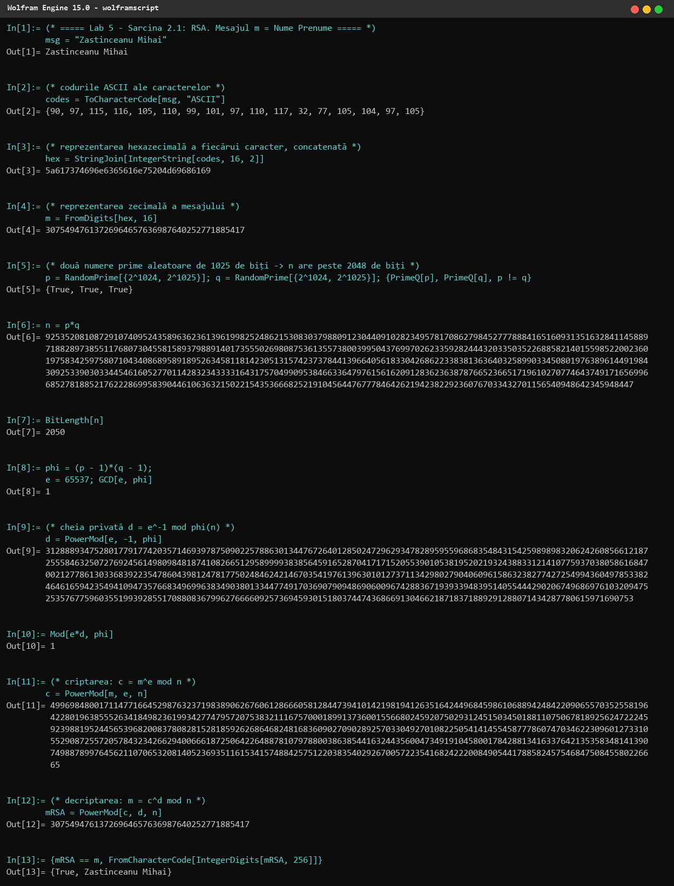
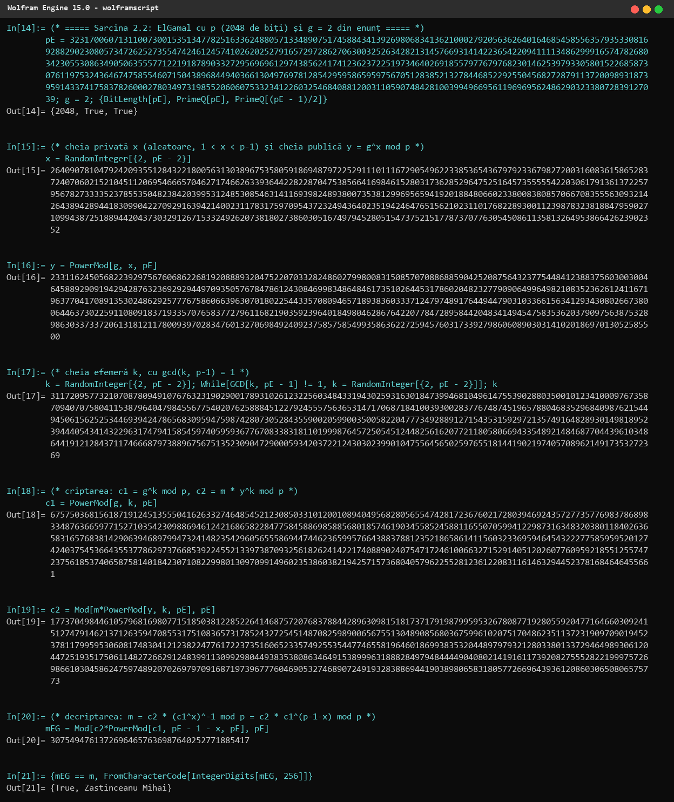
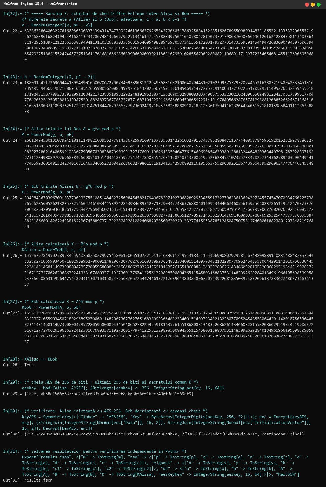
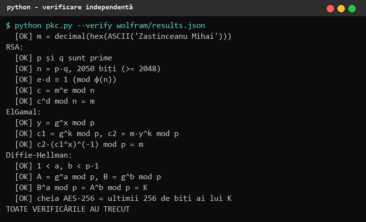

# 1. Sarcinile

- **Sarcina 2.1.** Generarea cheilor RSA (n de cel puțin 2048 de biți), criptarea și decriptarea mesajului m = „Nume Prenume” = **„Zastinceanu Mihai”**.
- **Sarcina 2.2.** Criptarea și decriptarea aceluiași mesaj cu algoritmul **ElGamal**, cu p (2048 de biți) și generatorul g = 2 date în enunț.
- **Sarcina 3.** Schimbul de chei **Diffie-Hellman** între Alisa și Bob, care folosesc algoritmul AES cu cheia de 256 de biți; numerele secrete a și b sunt alese aleatoriu.

Toate calculele au fost realizate în **Wolfram Engine 15.0** (limbajul Wolfram, rulat cu `wolframscript`), iar mesajul a fost convertit în număr zecimal prin reprezentarea hexazecimală ASCII, conform notei din enunț. Pentru siguranță, toate valorile obținute în Wolfram au fost verificate independent cu un script Python propriu (`lab5/pkc.py --verify`).

# 2. Reprezentarea numerică a mesajului

| Caracter | Z | a | s | t | i | n | c | e | a | n | u | ␣ | M | i | h | a | i |
|---|---|---|---|---|---|---|---|---|---|---|---|---|---|---|---|---|---|
| ASCII | 90 | 97 | 115 | 116 | 105 | 110 | 99 | 101 | 97 | 110 | 117 | 32 | 77 | 105 | 104 | 97 | 105 |
| Hex | 5A | 61 | 73 | 74 | 69 | 6E | 63 | 65 | 61 | 6E | 75 | 20 | 4D | 69 | 68 | 61 | 69 |

Concatenând codurile hexazecimale obținem `5A617374696E6365616E75204D69686169`, iar trecând în baza 10:

    m = 30754947613726964657636987640252771885417

În Wolfram: `ToCharacterCode[msg, "ASCII"]` dă codurile, `IntegerString[codes, 16, 2]` scrie fiecare cod cu 2 cifre hex, iar `FromDigits[hex, 16]` face conversia în zecimal. Operația inversă (după decriptare) este `FromCharacterCode[IntegerDigits[m, 256]]`: cifrele în baza 256 ale numărului sunt chiar octeții mesajului.

# 3. Sarcina 2.1 — RSA

## 3.1 Algoritmul

1. Se aleg două numere prime mari, diferite, p și q; n = p·q (modulul), φ(n) = (p − 1)(q − 1).
2. Se alege exponentul public e, 1 < e < φ(n), cu gcd(e, φ(n)) = 1. Am ales valoarea standard e = 65537 = 2^16 + 1 (primă, cu doar doi biți de 1 — exponențiere rapidă).
3. Exponentul privat d = e^(−1) mod φ(n), adică e·d ≡ 1 (mod φ(n)).
4. Cheia publică: (e, n); cheia privată: (d, n).
5. Criptarea: c = m^e mod n (se cere m < n). Decriptarea: m = c^d mod n.

Corectitudinea: c^d = m^(e·d) = m^(1 + t·φ(n)) ≡ m (mod n), conform teoremei lui Euler (și a teoremei chineze a resturilor pentru cazul gcd(m, n) ≠ 1).

## 3.2 Calculele în Wolfram

Comentarii pe pași:

- **In[1]–In[4]:** conversia mesajului în m (vezi secțiunea 2).
- **In[5]:** `RandomPrime[{2^1024, 2^1025}]` generează două prime aleatoare de 1025 de biți; `PrimeQ` confirmă primalitatea, iar p ≠ q. Am ales intervalul [2^1024, 2^1025] ca produsul să aibă sigur peste 2048 de biți.
- **In[6]–In[7]:** n = p·q are **2050 de biți** (≥ 2048, cerința este îndeplinită).
- **In[8]:** φ(n) = (p − 1)(q − 1) și gcd(65537, φ(n)) = 1 — deci e poate fi folosit.
- **In[9]–In[10]:** `PowerMod[e, -1, phi]` calculează inversul modular d (algoritmul lui Euclid extins); verificarea Mod[e·d, φ(n)] = 1.
- **In[11]:** criptograma c = m^e mod n — `PowerMod` folosește exponențierea rapidă modulară.
- **In[12]–In[13]:** decriptarea c^d mod n redă exact m, iar conversia inversă dă textul „Zastinceanu Mihai”.

# 4. Sarcina 2.2 — ElGamal

## 4.1 Algoritmul

Parametrii publici: p prim (2048 de biți) și generatorul g = 2.

1. **Generarea cheilor:** cheia privată x aleatoare, 1 < x < p − 1; cheia publică y = g^x mod p.
2. **Criptarea:** se alege o cheie efemeră k aleatoare, 1 < k < p − 1 (am cerut și gcd(k, p − 1) = 1); criptograma este perechea (c1, c2): c1 = g^k mod p, c2 = m·y^k mod p.
3. **Decriptarea:** s = c1^x mod p = g^(kx) = y^k; m = c2·s^(−1) mod p. Inversul se calculează ca s^(p−2) sau, echivalent, m = c2·c1^(p−1−x) mod p (mica teoremă a lui Fermat: c1^(p−1) ≡ 1).

Securitatea se bazează pe problema logaritmului discret: din y = g^x mod p nu se poate afla x în timp practic. k trebuie să fie nou pentru fiecare mesaj — altfel, din două criptograme cu același k se obține raportul mesajelor.

Despre p: în In[14] se vede că p are 2048 de biți, este prim și (p − 1)/2 este de asemenea prim, deci p este un **prim sigur** (safe prime; este grupul MODP de 2048 de biți din RFC 3526). Deoarece p ≡ 7 (mod 8), 2 este rest pătratic modulo p, deci g = 2 generează subgrupul de ordin q = (p − 1)/2 — un subgrup mare, de ordin prim, ceea ce este exact ce se dorește în practică.

## 4.2 Calculele în Wolfram

- **In[14]:** p și g din enunț; verificarea: 2048 de biți, p prim, (p − 1)/2 prim.
- **In[15]–In[16]:** cheia privată x = `RandomInteger[{2, p − 2}]` și cheia publică y = g^x mod p.
- **In[17]:** cheia efemeră k; bucla `While` alege alt k până când gcd(k, p − 1) = 1.
- **In[18]–In[19]:** criptograma (c1, c2).
- **In[20]–In[21]:** decriptarea c2·c1^(p−1−x) mod p redă m și textul „Zastinceanu Mihai”.

# 5. Sarcina 3 — Diffie-Hellman pentru o cheie AES-256

## 5.1 Protocolul

Alisa și Bob cunosc parametrii publici p și g = 2.

1. Alisa alege secretul a (1 < a < p − 1) și trimite lui Bob A = g^a mod p.
2. Bob alege secretul b (1 < b < p − 1) și trimite Alisei B = g^b mod p.
3. Alisa calculează K = B^a mod p = g^(ab) mod p; Bob calculează K = A^b mod p = g^(ab) mod p — aceeași valoare.
4. Un atacator vede doar p, g, A, B; pentru a afla K ar trebui să rezolve problema Diffie-Hellman (practic, logaritmul discret).

Secretul comun K are 2048 de biți, iar AES-256 cere o cheie de exact **256 de biți**; am luat **ultimii 256 de biți ai lui K**: cheia = K mod 2^256. (Într-un sistem real s-ar folosi o funcție de derivare a cheii, de exemplu HKDF cu SHA-256, dar trunchierea arată clar ideea și dă aceeași cheie ambelor părți.) Protocolul în forma de bază nu autentifică părțile, deci este vulnerabil la atacul „man-in-the-middle” — în practică A și B se semnează (vezi Lab 6) sau se folosesc certificate.

## 5.2 Calculele în Wolfram

- **In[22]–In[23]:** numerele secrete a și b, alese aleatoriu cu `RandomInteger[{2, p − 2}]`.
- **In[24]–In[25]:** valorile publice A și B schimbate între Alisa și Bob.
- **In[26]–In[28]:** Alisa calculează B^a mod p, Bob calculează A^b mod p — rezultatele sunt identice (`True`).
- **In[29]:** cheia AES-256 = K mod 2^256:

      98f93bff2dbfbd51c038c074aa96cc410a420da62233798282c0d84b3d39ec2d

- **In[30]:** verificare practică: cu această cheie Alisa criptează mesajul cu AES-256 (`SymmetricKey` + `Encrypt`, mod CBC), iar Bob îl decriptează cu cheia calculată de el (`Decrypt`) și obține „Zastinceanu Mihai”. Criptograma și vectorul de inițializare au fost decriptate și în Python (pycryptodome, AES-256-CBC) cu aceeași cheie, rezultatul fiind același mesaj.
- **In[31]:** valorile sunt salvate în `results.json` pentru verificare.

# 6. Verificarea independentă

Scriptul `lab5/pkc.py` reia toate relațiile cu aritmetica Python (test Miller-Rabin pentru primalitate, `pow` modular) pe valorile exportate de Wolfram:

Toate valorile complete (numere de 617 cifre) se găsesc în `lab5/wolfram/results.json`, iar sesiunea Wolfram completă în `lab5/wolfram/transcript.txt`.

# 7. Concluzii

Am generat chei RSA cu un modul de 2050 de biți și am realizat criptarea/decriptarea numelui meu, apoi am făcut același lucru cu ElGamal în grupul de 2048 de biți dat și am realizat schimbul de chei Diffie-Hellman, din care am derivat o cheie AES-256 funcțională. Am observat diferențele practice dintre algoritmi: RSA este determinist (același m dă mereu același c, dacă nu se folosește padding aleator precum OAEP), pe când ElGamal este probabilist — fiecare criptare cu alt k dă altă criptogramă, dar criptograma este de două ori mai lungă. Securitatea RSA se bazează pe dificultatea factorizării lui n, iar a ElGamal și Diffie-Hellman pe problema logaritmului discret; toate necesită numere de peste 2048 de biți, ceea ce face criptografia cu chei publice mult mai lentă decât cea simetrică. De aceea în practică se combină: un algoritm cu chei publice (aici Diffie-Hellman) stabilește cheia, iar datele se criptează cu AES.

# 8. Codul sursă

Depozitul GitHub (ramura `Cripto`): https://github.com/mihaizastinceanu/Cripto/tree/Cripto/lab5

- `wolfram/lab5.wl` — toate comenzile Wolfram; `wolfram/transcript.txt` — sesiunea completă;
- `pkc.py` — implementarea de referință și verificarea în Python.
