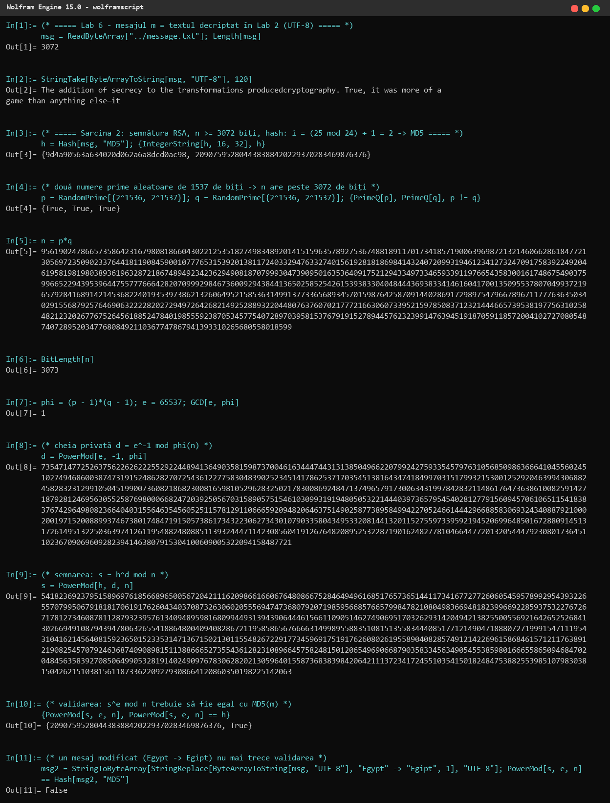
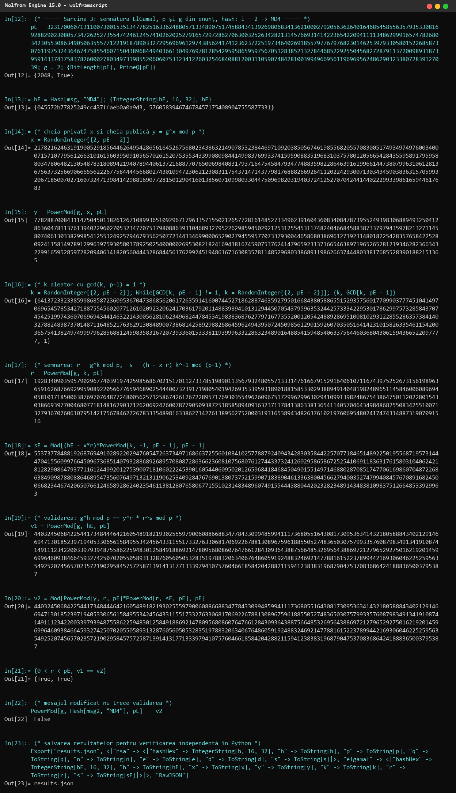
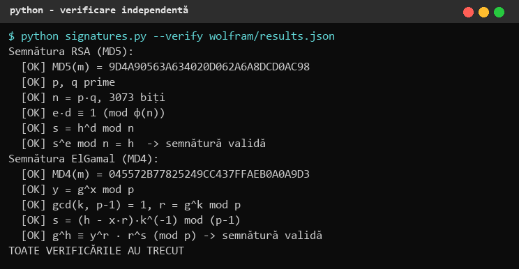

# 1. Sarcinile

Mesajul m este textul obținut în **Lab 2** (decriptarea criptogramei V2, fragmentul din „The Codebreakers” de D. Kahn), salvat în `lab6/message.txt`: 3072 de octeți, codificare UTF-8, sfârșit de linie LF.

Numărul meu de ordine în lista grupei este k = 25, deci indicele funcției hash este i = (25 mod 24) + 1 = **2**:

- **Sarcina 2** — semnătura **RSA**, n de cel puțin 3072 de biți, funcția hash nr. 2 din prima listă: **MD5**;
- **Sarcina 3** — semnătura **ElGamal**, cu p (2048 de biți) și g = 2 din enunț, funcția hash nr. 2 din a doua listă: **MD4**.

Calculele au fost realizate în **Wolfram Engine 15.0** (`wolframscript`), iar toate rezultatele au fost verificate independent în Python (`lab6/signatures.py --verify`).

# 2. Noțiuni teoretice

## 2.1 Funcții hash

O funcție hash criptografică h = H(m) transformă un mesaj de lungime arbitrară într-o amprentă de lungime fixă și trebuie să fie: rezistentă la preimagine (din h nu se poate găsi m), rezistentă la a doua preimagine și rezistentă la coliziuni (nu se pot găsi m ≠ m' cu H(m) = H(m')). Orice modificare a mesajului schimbă complet valoarea hash (efectul de avalanșă).

- **MD4** (R. Rivest, 1990) și **MD5** (1991) produc amprente de **128 de biți**, construite după schema Merkle-Damgård: mesajul este completat (padding + lungimea pe 64 de biți) la un multiplu de 512 biți și procesat bloc cu bloc de o funcție de compresie cu 3 runde (MD4), respectiv 4 runde (MD5) de câte 16 operații.
- Ambele sunt astăzi **sparte**: coliziuni pentru MD4 se găsesc „de mână” (Dobbertin 1996, Wang 2004), iar pentru MD5 în câteva secunde (Wang 2004; în 2008 s-a creat un certificat CA fals folosind coliziuni MD5). Nu trebuie folosite pentru semnături reale — aici sunt impuse de varianta lucrării; în practică se folosește SHA-256 sau SHA-3.

Semnătura se aplică valorii hash, nu întregului mesaj: este mult mai scurtă (128 de biți față de 3072 de octeți) și încape în modulul n (h < n), iar orice modificare a mesajului schimbă h și invalidează semnătura.

## 2.2 Semnătura RSA

Cheile (e, n) publică și (d, n) privată se generează ca în Lab 5. Semnarea: **s = h^d mod n** (cu cheia privată); validarea: semnătura e corectă dacă **s^e mod n = h** (cu cheia publică). Doar posesorul lui d putea produce un s cu această proprietate.

## 2.3 Semnătura ElGamal

Parametrii publici p, g; cheia privată x, cheia publică y = g^x mod p.

- Semnarea: se alege k aleator cu gcd(k, p − 1) = 1; **r = g^k mod p**, **s = (h − x·r)·k^(−1) mod (p − 1)**; semnătura este perechea (r, s).
- Validarea: 0 < r < p și **g^h ≡ y^r · r^s (mod p)**.

Corectitudinea: din s·k ≡ h − x·r (mod p − 1) rezultă h ≡ x·r + k·s (mod p − 1), deci g^h = g^(xr)·g^(ks) = y^r·r^s (mod p). k trebuie păstrat secret și nu trebuie refolosit: din două semnături cu același k se poate calcula cheia privată x.

# 3. Sarcina 2 — semnătura RSA cu MD5

Comentarii pe pași:

- **In[1]–In[2]:** `ReadByteArray` citește mesajul exact ca șir de octeți (3072 de octeți); se afișează începutul textului. Citirea ca octeți asigură că Wolfram și Python calculează hash-ul pe aceleași date.
- **In[3]:** `Hash[msg, "MD5"]` dă amprenta de 128 de biți:

      MD5(m) = 9d4a90563a634020d062a6a8dcd0ac98 (hex)
             = 209075952804438388420229370283469876376 (zecimal)

  Pentru semnare se folosește reprezentarea zecimală, conform notei din enunț.
- **In[4]–In[6]:** p și q — prime aleatoare din [2^1536, 2^1537] (1537 de biți fiecare), deci n = p·q are **3073 de biți** (≥ 3072).
- **In[7]–In[8]:** e = 65537, gcd(e, φ(n)) = 1; cheia privată d = e^(−1) mod φ(n).
- **In[9]:** **semnarea**: s = h^d mod n.
- **In[10]:** **validarea**: s^e mod n = 209075952804438388420229370283469876376 = MD5(m) → `True`, semnătura este validă.
- **In[11]:** în mesaj se înlocuiește un singur cuvânt („Egypt” → „Egipt”); MD5 al mesajului modificat este altul, deci validarea dă `False` — semnătura protejează integritatea mesajului.

# 4. Sarcina 3 — semnătura ElGamal cu MD4

- **In[12]:** p (2048 de biți, prim) și g = 2 din enunț.
- **In[13]:** `Hash[msg, "MD4"]`:

      MD4(m) = 045572b77825249cc437ffaeb0a0a9d3 (hex)
             = 5760583946746784571754089047555877331 (zecimal)

- **In[14]–In[15]:** cheia privată x aleatoare din [2, p − 2] și cheia publică y = g^x mod p.
- **In[16]:** k aleator, ales din nou până când gcd(k, p − 1) = 1 (necesar ca să existe k^(−1) mod (p − 1)); al doilea element afișat confirmă gcd = 1.
- **In[17]:** r = g^k mod p.
- **In[18]:** s = (h − x·r)·k^(−1) mod (p − 1) — `PowerMod[k, -1, p − 1]` calculează inversul lui k.
- **In[19]–In[21]:** **validarea**: v1 = g^h mod p și v2 = y^r·r^s mod p sunt egale, iar 0 < r < p → semnătura (r, s) este validă.
- **In[22]:** pentru mesajul modificat, g^(MD4(m')) ≠ y^r·r^s → semnătura nu mai este validă.
- **In[23]:** valorile se salvează în `results.json`.

# 5. Verificarea independentă

Scriptul `lab6/signatures.py` recalculează MD5 (`hashlib`) și MD4 (`pycryptodome`, deoarece OpenSSL 3 nu mai oferă MD4 în mod implicit) pe același fișier și verifică toate relațiile pe valorile exportate de Wolfram:

Hash-urile calculate de Wolfram și de Python coincid, iar ambele semnături sunt valide. Valorile complete se găsesc în `lab6/wolfram/results.json` și `lab6/wolfram/transcript.txt`.

# 6. Concluzii

Am semnat și am validat mesajul din Lab 2 cu două scheme: RSA (modul de 3073 de biți, hash MD5) și ElGamal (p de 2048 de biți, hash MD4). Semnătura RSA este un singur număr de dimensiunea lui n și se verifică rapid (e mic), în timp ce semnătura ElGamal este o pereche (r, s) și depinde de un k aleator, deci același mesaj are de fiecare dată altă semnătură. În ambele cazuri modificarea unui singur cuvânt din text a fost detectată, deoarece hash-ul se schimbă complet. Am înțeles și că securitatea semnăturii nu poate depăși securitatea funcției hash: pentru MD4 și MD5 se pot construi coliziuni, astfel încât un atacator ar putea pregăti două documente diferite cu aceeași semnătură; de aceea în sistemele reale (de exemplu în PKI-ul din Lab 5 v2) se folosește SHA-256 sau mai puternic.

# 7. Codul sursă

Depozitul GitHub (ramura `Cripto`): https://github.com/mihaizastinceanu/Cripto/tree/Cripto/lab6

- `wolfram/lab6.wl` — comenzile Wolfram; `wolfram/transcript.txt` — sesiunea completă;
- `signatures.py` — implementarea de referință și verificarea în Python; `message.txt` — mesajul semnat.
